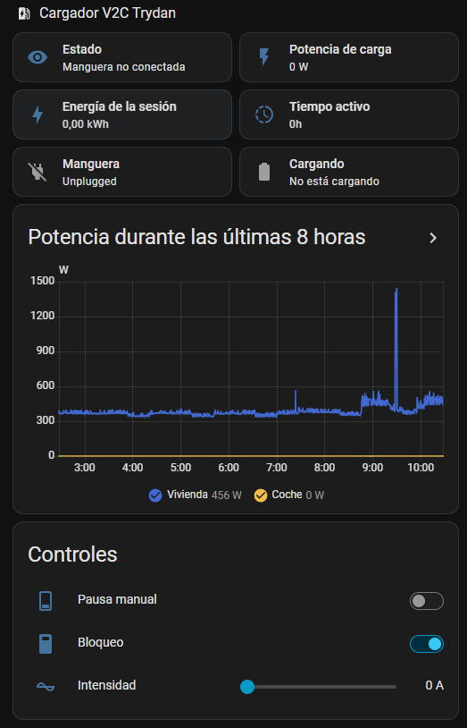
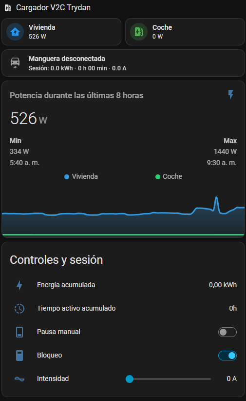

# V2C Trydan for Home Assistant

[](https://hacs.xyz/)
[](https://github.com/Carbanog/V2C_trydan/releases/)
[English](README.md) · [Español](README.es.md) · [Français](README.fr.md)

Local charger control, complete charging-session tracking, and optional tools
for managing charging from Home Assistant.

V2C Trydan combines everyday controls, persistent sessions across pauses and
restarts, diagnostics and reusable automations. The beta branch adds optional
weekly tariff scheduling without relying on an energy provider.

## Releases and scope

| Channel | Version | Purpose |
| --- | --- | --- |
| Stable | [1.3.3](https://github.com/Carbanog/V2C_trydan/releases/tag/v1.3.3) | Monitoring, controls and sessions. |
| Opt-in beta | [1.4.0b3](https://github.com/Carbanog/V2C_trydan/releases/tag/v1.4.0b3) | Adds optional scheduling; test installations only. |

The beta does not replace the latest stable release. Features labelled beta below
are experimental, not part of 1.3.3. See the [changelog](CHANGELOG.md).
Install through HACS as a **custom repository**; this project is not presented
as included in the default HACS catalog.

## Features

- Local HTTP; no V2C Cloud account or Octopus/OCPP required.
- Pause, lock and current controls, with optional advanced settings.
- Whole-session energy and active time across firmware counter resets.
- Session restoration after HA restarts.
- Shared serialized requests, bounded retries and communication diagnostics,
  also useful for constrained PLC/Wi-Fi connections.
- IP reconfiguration without recreating the integration; redacted diagnostic fields.
- Optional blueprints, dashboard examples and English/Spanish/French UI.

Fault tolerance does not eliminate network problems or guarantee connectivity.

## Requirements and compatibility

HA must reach the charger's local HTTP API. Reserve its address in your router
and check `http://CHARGER_IP/RealTimeData` on the same network.
Do not expose that API to the Internet.

Tests include anonymized real responses from firmware 2.4.6 and 2.5.1; this does
not physically validate every firmware or installation. Optional fields are
detected by presence rather than firmware number alone. Firmware 2.5.2 and
Trydan Pro master/secondary arrangements remain unverified.

Measured L1 current/voltage entities appear when reported by the charger.
L2/L3 measurements and light controls are not exposed; the latter were removed
because local states were inconsistent. Local brand icons are served by
HA 2026.3 and later.

## Installation

[](https://my.home-assistant.io/redirect/hacs_repository/?owner=Carbanog&repository=V2C_trydan&category=integration)

1. Back up HA.
2. Use the button or add `https://github.com/Carbanog/V2C_trydan` in HACS as a
   custom **Integration** repository.
3. Download stable **1.3.3** and restart HA.
4. Open **Settings → Devices & services → Add integration → V2C Trydan**.
5. Enter the charger's local IP address.

Without HACS, download a release and copy only `custom_components/v2c_trydan`
to `/config/custom_components/v2c_trydan`; restart and continue from step 4.
Do not install two implementations using the `v2c_trydan` domain side by side.
Avoid competing controllers/automations sending contradictory commands.

## Updates, beta testing and rollback

Update through HACS and restart. Do not delete/recreate the integration:
existing IDs, customizations and stored sessions are retained. Use **Reconfigure**
if the IP changes. Reload after firmware upgrades to discover available optional fields.

To try **1.4.0b3**, explicitly select it in HACS's re-download/version selector,
showing prereleases if needed, on test HA only. Do not enable beta updates in
production or let two HA instances govern the same charger.

To roll back, review the actual pause state, disable scheduling if it was enabled,
download **1.3.3** and restart. Disabling/unloading does not automatically resume
charging. Beta-only entities can remain unavailable after rollback; user registry
records are not automatically deleted.

## Entities and configuration

| Group | Contents |
| --- | --- |
| Everyday controls | Pause charge, lock charger and manual current. |
| Session | Session energy, active time and optional reset button. |
| Monitoring | Charging power/partial energy, charge state, house power, cable/charging states. |
| Optional settings | Current limits, dynamic charging/mode, timer and dynamic pause. |
| Optional diagnostics/measurements | Meter, firmware, network, Wi-Fi, raw states, measured L1 voltage/current. |
| Beta scheduling | Mode, current tariff and status; only when enabled. |

New installs keep advanced settings, solar/home-battery data and many diagnostic
entities disabled. Existing entity choices survive updates. Enable what you need
under **Settings → Devices & services → Entities**, including disabled entities
in the filter. Enabling an entity alone does not modify the charger.

Choose your language in the HA profile. Existing entity IDs, customized names
and manually written dashboard text are not automatically renamed.

## Session accounting

**Charge Energy** is the firmware's partial counter. **Session Energy** and
**Session Active Charging Time** accumulate increments across pauses and counter
resets. They do not depend on Octopus and also work with manual charging.

Totals remain after unplug for delayed summaries; the next observed connection
starts a new session. Charger faults do not start a new session on recovery.
State is checkpointed independently of Recorder. An optional reset button
handles exceptional corrections.

Display precision is two decimals; time is stored in seconds. If an older entity
still displays seconds, choose hours in its settings without resetting its total.
Energy erased by the charger while HA was offline cannot be reconstructed.

## Tariff scheduling — 1.4 beta only

A separate, optional module, **disabled by default**, with no helpers or
automations to create. Configure multiple blocks per day, different weekdays,
Peak/Shoulder/Off-peak labels and overnight intervals. Utility hours, holidays
and prices are not assumed or fetched.

In **Configure**, add or edit blocks, choose permitted tariffs and enable the module.
**Save and apply** shows enabled state, blocks and gaps, then requires explicit
confirmation. Overlaps are rejected; unassigned time does not permit charging.

| Mode | Behavior |
| --- | --- |
| Automatic | Permits charging only in selected tariff periods. |
| Charge now | Ignores tariffs until an observed connection followed by unplug. |
| Paused | Latches a stop until another mode is chosen. |

First activation starts Paused. Only `Paused` is written: the policy never
unlocks the charger or changes current/dynamic regulation. While enabled, the
existing pause switch selects Paused when on, and Charge now when off.
Status explains waiting, shows the next window as an attribute, and raises a
**Repairs** warning if an attempted command stays unconfirmed for one minute.

**HA must remain running and connected.** An outage can prevent stopping at a
boundary; an unplug/replug entirely during downtime may go undetected.
The next window previews tariff permission, not a guaranteed vehicle start.
Do not combine with OCPP/Octopus or other charging schedules. Leave dynamic
regulation and electrical protections enabled.

[Full beta setup, physical-test and rollback guide](https://github.com/Carbanog/V2C_trydan/blob/v1.4.0b3/docs/scheduling.md).
Promotion to stable is pending physical charging checks.

## Blueprints and automations

Optional imports live in [blueprints/automation](blueprints/automation).
They are never automatically installed or enabled.

**Session summary and notifications**

[](https://my.home-assistant.io/redirect/blueprint_import/?blueprint_url=https%3A%2F%2Fgithub.com%2FCarbanog%2FV2C_trydan%2Fblob%2Fv1.4.0b3%2Fblueprints%2Fautomation%2Fsession_summary.yaml)

[View YAML](blueprints/automation/session_summary.yaml). Runs start/end actions
without repeating every OCPP pause. Finish actions can use `session_kwh`,
`session_seconds`, `session_hours`, `session_duration`, `estimated_percent`,
`estimated_cost` and `estimated_range_km`.

Example finish action; replace the notification service:
```yaml
action: notify.mobile_app_your_phone
data:
  title: Charging finished
  message: "{{ session_kwh }} kWh · {{ session_duration }}"
```

**High charging power alert**

[](https://my.home-assistant.io/redirect/blueprint_import/?blueprint_url=https%3A%2F%2Fgithub.com%2FCarbanog%2FV2C_trydan%2Fblob%2Fv1.4.0b3%2Fblueprints%2Fautomation%2Fhigh_power_alert.yaml)

[View YAML](blueprints/automation/high_power_alert.yaml). Runs chosen actions
after a power threshold is exceeded for a configured duration; exposes `measured_power`.

Vehicle capacity, efficiency, price and consumption are optional blueprint inputs.
Battery-added percentages, cost and range are estimates for notifications, not
vehicle-reported SOC or newly created sensors.

## Dashboards

- [Native](dashboards/native.en.yaml): standard HA cards.
- [Mushroom](dashboards/mushroom.en.yaml): requires Mushroom and Mini Graph Card.

Paste the YAML into a manual card and adapt entity IDs to your installation.
The integration never changes your dashboards automatically.

| Native dashboard | Mushroom dashboard |
| :---: | :---: |
| [](docs/images/dashboard-native.png) | [](docs/images/dashboard-mushroom.png) |

Screenshots show the Spanish interface; entity text follows your HA language.

## Compatibility actions

New automations should normally target `switch`, `number` and `select` entities.
Compatibility actions remain available: `v2c_trydan.set_intensity`,
`v2c_trydan.set_min_intensity`, `v2c_trydan.set_max_intensity` and
`v2c_trydan.set_dynamic_power_mode`. Supply `config_entry_id` when needed to
select one of multiple chargers.

They do not replace every V2C app setting. Do not change protection-related
current limits, dynamic charging or advanced modes without understanding the installation.

## Diagnostics and limits

One shared poll every **15 s**, a **20 s** read timeout and up to **3 attempts**
for transient failures, separated by **2 s**. Requests are serialized per charger.
Permanent HTTP errors, redirects and invalid snapshots remain visible.
Writes require `OK` and are not blindly repeated.

For a report, enable debug logging in the integration menu, wait for failure and
recovery, then disable logging and download logs/diagnostics. They include read
attempts, elapsed time, latest failure and observed recovery.
Automatic recovery alone does not identify a network root cause.
Known IP, SSID and hardware-ID fields are redacted from diagnostics, but review
all logs and screenshots before publishing.

There is no real vehicle SOC, kilometre charging target, PVPC integration or
automatic price optimization. Beta scheduling is neither a safety mechanism
nor a guarantee of tariff compliance during HA/network downtime.

## Contributing and HACS readiness

Use [Issues](https://github.com/Carbanog/V2C_trydan/issues) with integration/HA/
firmware versions, reproduction steps and reviewed, privacy-safe diagnostics.
Maintained languages are English, Spanish and French; native wording corrections
are welcome. Add languages when there is demand and someone to maintain them.

[Architecture and development](docs/architecture.md) ·
[HACS catalog readiness checklist](docs/hacs-readiness.md).

Checks include Ruff, pytest, hassfest and HACS. The beta branch also tests actual
HA lifecycle with a mocked charger; this does not replace physical verification.
Default HACS catalog inclusion requires a separate submission and review.

## License and credits

An independent project maintained by [Carbanog](https://github.com/Carbanog),
not affiliated with V2C or Home Assistant. It began from
[Rain1971's work](https://github.com/Rain1971/V2C_trydant) and has evolved with its
own functionality and architecture while retaining that acknowledgement.

[MIT license](LICENSE), with original-author and Carbanog copyright notices
preserved. Thanks to the community and AI tools used during development/review.
Icon provenance is documented in [brand-assets](docs/brand-assets.md).
Optional support is available in **Sponsor this project** in the repository sidebar.
